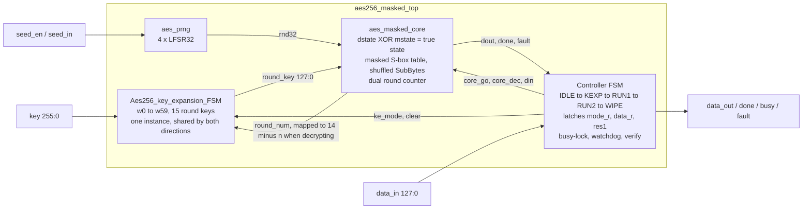
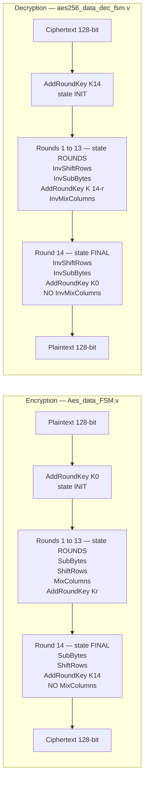
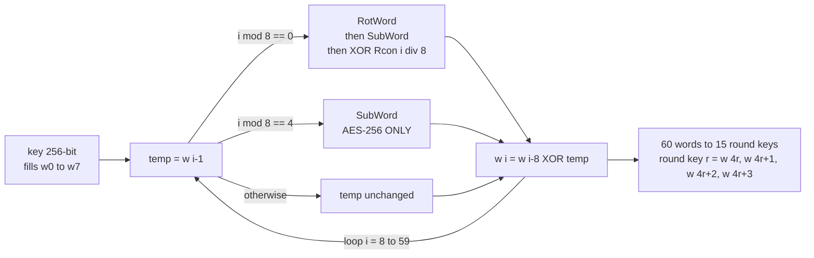
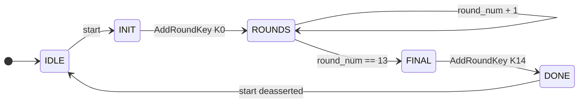
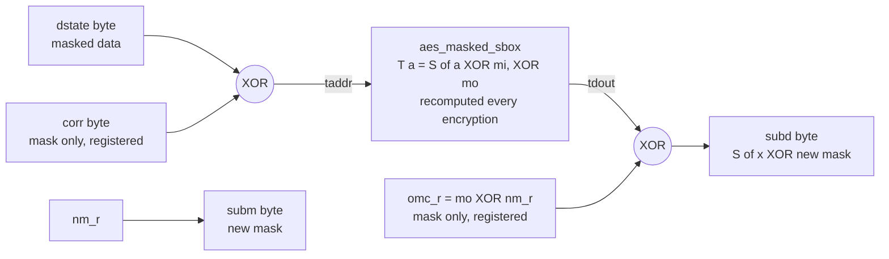

# AES-256 Encryption and Decryption System with Verilog

An AES-256 encrypt/decrypt core in Verilog HDL, hardened against **fault-injection** and **power analysis** attacks.

The repository contains four top modules that build on each other, so the cost of each countermeasure can be measured instead of assumed. Every variant is verified against an independent AES reference implementation.

| Top module | What it adds | Cycles / block | Status |
|---|---|---:|---|
| `aes256_enc_dec_top` | Input latching, busy-lock, verify-after-compute, dual round counter, zeroize | 50 | verified |
| `aes256_enc_dec_top_cached` | Key schedule computed once per key instead of per block | 38 | verified |
| `aes256_masked_top` | First-order Boolean masking, shuffling, masked S-box | 1017 | verified |
| `aes256_masked_top_mk` | Masked key expansion, Block RAM option | 1032 | verified |

---

## Architecture



The feedback edge from the core back to the key expansion is what lets a **single** key-expansion block serve both directions: the core asks for round `n`, and the top maps it to `14 - n` when decrypting. The original design instantiated one key expansion per direction, which stored two copies of the key schedule in flip-flops.

---

## AES-256 algorithm



Two details that are easy to get wrong and are worth pointing at:

* **Round 14 drops MixColumns** in both directions. Omitting this check is the most common AES bug.
* **Decryption is not a plain mirror of encryption.** Encryption puts AddRoundKey at the end of a round; decryption puts it in the middle, before InvMixColumns. This follows from InvMixColumns being linear, so it can be commuted with AddRoundKey only if the round keys are transformed too — this design chooses not to transform them.

One AES round takes **one clock cycle** in the unmasked cores.

---

## Key expansion



The `i mod 8 == 4` branch exists **only** in AES-256 — AES-128 and AES-192 have no equivalent. Leaving it out produces a key schedule that looks plausible and fails every test vector.

Round keys do not depend on direction, which is why decryption reuses this block instead of needing a second one.

---

## Control FSM



A second, independent counter runs **backwards** from 14 to 0 alongside `round_num`. Entering `FINAL` with the two counters disagreeing means a round was skipped, which raises `fault` and forces `data_out` to zero. A reduced-round ciphertext is exactly what Differential Fault Analysis needs to recover a key, so it must never leave the chip.

---

## Security features

### Against fault injection

* **Dual round counter** — a skipped or injected round is detected before any output is produced.
* **Verify-after-compute** — every encryption is decrypted again and compared against the original input. Any single-bit fault anywhere in the datapath breaks the round trip. This is what makes the latency figures above roughly double.
* **Illegal FSM state detection** — `default` branches raise `fault` instead of silently recovering, and the FSMs carry `fsm_safe_state = "reset_state"`.
* **Watchdog** — a run that does not finish in time is aborted and zeroized.
* **On fault, output is forced to zero.** Nothing partial is ever emitted.

### Against power analysis — masked variants



* **First-order Boolean masking with per-byte masks.** The invariant `dstate XOR mstate = true state` holds throughout; the true value never lands in any register. Because MixColumns is linear, a second MixColumns instance runs on the mask path — this is the largest area cost of the masked variants.
* **Shuffling.** The 16 S-box lookups of each round are performed in a randomized order, which lowers the signal-to-noise ratio available to an attacker.
* **Table-based masked S-box.** The nonlinear step is a RAM lookup rather than masked combinational logic. Boolean masking over glitchy combinational logic leaks at first order (Mangard et al., 2005); keeping the nonlinearity in memory avoids most of that.
* **Masks are redrawn for every single encryption.** Reusing a mask across blocks would let an attacker average it away.
* **Zeroize.** Key schedule, mask state, intermediate state and latched inputs are cleared after every operation.

### Two places synthesis must not "optimize"

Writing `dstate[j] ^ mstate[j] ^ mi` as one expression lets the tool compute `dstate[j] ^ mstate[j]` first — and that intermediate **is the unmasked byte**. The same applies to `tdout ^ mo ^ nm_r`.

The design therefore precomputes `corr = mstate ^ {16{mi}}` and `omc_r = mo ^ nm_r` into **registers** one cycle ahead, so only a single XOR remains at each point. Both registers carry `dont_touch`. After synthesis it is worth confirming in the schematic, and adding to the XDC:

```tcl
set_property DONT_TOUCH true [get_cells -hier -filter {NAME =~ *corr_reg*}]
set_property DONT_TOUCH true [get_cells -hier -filter {NAME =~ *omc_r_reg*}]
```

---

## Limitations — read before claiming this is DPA-proof

This section matters more than the feature list.

1. **The PRNG is an LFSR, which is not cryptographically secure.** An LFSR is linear: a few consecutive outputs reveal the whole sequence. If an attacker can predict the mask stream, every masking countermeasure above collapses. `seed_en` / `seed_in` **must** be driven from a physical entropy source — a ring-oscillator TRNG, or a seed delivered from the PS over AXI at boot. Leaving `seed_en` tied low means the mask sequence repeats identically on every power-up, which is equivalent to having no masking at all.

2. **Measured evidence that this matters.** Over 1000 simulated traces, the correlation between the Hamming weight of the state register and that of the true value after round-0 AddRoundKey drops from `1.0000` (unmasked) to `-0.0065` (masked, noise floor at 3 sigma is 0.095). But the worst per-bit correlation was `0.1252` against an expected noise maximum of `0.101` — about 4 sigma. The most likely cause is that the 16 mask bytes of one encryption come from consecutive LFSR outputs and are therefore correlated with each other. That is an experimental argument for replacing the PRNG, not a theoretical one.

3. **Simulation is not a side-channel evaluation.** All numbers here come from functional simulation. Proving resistance requires TVLA on real hardware with a current probe and an oscilloscope. Nothing in this repository has been measured on a board.

4. **This is first-order masking.** Second-order attacks, which combine two leakage points, remain possible. Higher orders need d+1 shares.

5. **No formal glitch resistance.** Boolean masking on FPGA is not proven secure against glitches. The nonlinear part is a RAM lookup, which helps, but the XOR trees in MixColumns still glitch. A mathematical guarantee requires Threshold Implementation or Domain-Oriented Masking with register barriers between stages.

6. **Shuffling uses `j = cnt + a XOR x`**, giving 256 distinct orders rather than the full `16!`. A Fisher-Yates permutation generator would be stronger.

7. **Key schedule caching trades one risk for another.** `aes256_enc_dec_top_cached` keeps the key schedule in flip-flops across blocks. That reduces exposure to power analysis — fewer recomputations — but increases exposure to JTAG readback, scan and cold-boot attacks. If the device can be physically seized, prefer the uncached variant. Either way, `zeroize` must be asserted at the end of a session.

8. **Masking does not defeat full register readback.** In `aes256_masked_top_mk`, reading both `wd` and `wm` and XORing them recovers the key. Masking protects the *computation*, not the storage. Disable bitstream readback and assert `zeroize`.

---

## Verification

All results below were produced with Icarus Verilog against an independent AES-256 reference implementation — expected values were computed from the reference, never read back from the design.

| Testbench | Target | Result |
|---|---|---|
| `AES_ENC_DEC_TB` | `aes256_enc_dec_top` | 40 PASS / 0 FAIL across 20 key-plaintext pairs |
| `AES_SECURE_TB` | `aes256_enc_dec_top` | NIST vectors + 9 attack scenarios, 0 errors |
| `AES_CACHED_TB` | `aes256_enc_dec_top_cached` | 0 errors; key schedule computed once per key confirmed |
| `AES_MASKED_TB` | `aes256_masked_top` | 0 errors; masking invariant holds on every trace |
| `AES_MASKED_MK_TB` | `aes256_masked_top_mk` | 0 errors with both `SYNC_RAM=0` and `SYNC_RAM=1` |

Additional checks run during development:

* 200 random key/plaintext pairs, encrypt and decrypt — 400 operations, 0 mismatches against the reference.
* All three S-box tables verified complete and correct for all 256 entries.
* Attack scenarios, all of which raise `fault` and force a zero output: round skipping, single-bit flips mid-round, illegal FSM states, round-key corruption.
* Interface scenarios: changing `key`/`data_in`/`mode` after `start`, re-asserting `start` while busy, holding `start` high for thousands of cycles, operation after a fault, zeroize completeness.

### Running the simulations

```bash
iverilog -g2005 -s AES_SECURE_TB -o sim.vvp tb/AES_SECURE_TB.v rtl/*.v && vvp sim.vvp
iverilog -g2005 -s AES_MASKED_TB -o sim.vvp tb/AES_MASKED_TB.v rtl/*.v && vvp sim.vvp
```

In Vivado, from the Tcl Console at the project root:

```tcl
source scripts/add_new_sources.tcl      # register all RTL and testbenches
source scripts/cleanup_dead_sources.tcl # drop modules left over from the old architecture
synth_top aes256_masked_top             # the project has four top candidates, so lock one
sim_top   AES_MASKED_TB
```

The project must have its top set **explicitly**. With `TopAutoSet` left on and four candidate tops present, Vivado will pick one for you and it will be the wrong one.

---

## Repository layout

```
rtl/
  Aes256_ENC_DEC_top.v            top — hardened, unmasked
  Aes_data_FSM.v                  encryption datapath, 16 parallel S-boxes, 1 round/cycle
  aes256_data_dec_fsm.v           decryption datapath
  Aes256_key_expansion_FSM.v      15 round keys, with clear port for zeroize

  Aes256_ENC_DEC_top_cached.v     top — key schedule cached per key
  Aes256_key_expansion_cached.v   key cache plus key-change detection

  Aes256_masked_top.v             top — masked datapath
  aes_masked_core.v               masked core, both directions, shuffled SubBytes
  aes_masked_sbox.v               masked S-box table, distributed RAM
  aes_masked_sbox_bram.v          same table, synchronous read for Block RAM
  aes_prng.v                      mask source — REPLACE WITH A TRNG

  Aes256_masked_top_mk.v          top — masked datapath and masked key expansion
  aes_masked_core_mk.v            core with SYNC_RAM parameter
  Aes256_key_expansion_masked.v   key schedule stored as wd XOR wm

  Aes_Sbox.v  aes_inv_sbox.v              S-box tables, 256 entries each
  Aes_sub_bytes.v  aes_inv_sub_bytes.v    16 parallel byte substitutions
  Aes_shift_rows.v  aes_inv_shift_rows.v  byte permutation, pure wiring
  Aes_mix_columns.v  aes_inv_mix_columns.v  GF 2^8 matrix multiply

tb/
  AES_ENC_DEC_TB.v              20 vectors, encrypt and decrypt
  AES_SECURE_TB.v               NIST vectors plus fault and interface scenarios
  AES_MASKED_TB.v               adds masking-invariant checks
  AES_CACHED_TB.v               key-cache behaviour
  AES_MASKED_MK_TB.v            masked key expansion, both RAM styles
  Aes256_key_expansion_FSM_tb.v unit test for the key schedule

scripts/
  add_new_sources.tcl           add every file to a Vivado project and lock the top
  cleanup_dead_sources.tcl      remove the superseded wrapper modules

docs/
  block-diagrams.html           standalone page with the full set of block diagrams
```

`Aes256_FSM.v`, `Aes256_dec_FSM.v` and `Aes256_key_expansion_dec.v` were the per-direction wrappers of the original architecture. Each carried its own key expansion, which is where the duplicated key schedule came from. They are no longer instantiated by anything and have been removed; they remain available in the git history.

---

## Interface

```verilog
aes256_masked_top #(
    .VERIFY_EN (1),        // decrypt-back check, roughly doubles latency
    .WDT_MAX   (4000)
) u_aes (
    .clk      (clk),
    .reset    (reset_n),   // ACTIVE LOW, asynchronous
    .start    (start),     // rising edge only, ignored while busy
    .mode     (mode),      // 0 = encrypt, 1 = decrypt
    .key      (key),       // 256-bit
    .data_in  (data_in),   // 128-bit
    .seed_en  (seed_en),   // drive from a TRNG — see Limitations
    .seed_in  (seed_in),
    .data_out (data_out),
    .done     (done),
    .busy     (busy),
    .fault    (fault)      // 1 = attack or error detected, data_out forced to zero
);
```

`key`, `data_in` and `mode` are latched on the clock edge that accepts `start`, so they may change immediately afterwards. A `start` arriving while `busy` is high is ignored completely; the in-flight operation is not disturbed.

---

## Project goal

Design, implement and verify an AES-256 cryptographic system in Verilog HDL, and then treat it as a real security target: find the ways a correct-looking implementation still leaks, measure what each countermeasure costs, and be precise about what the result does and does not guarantee.
